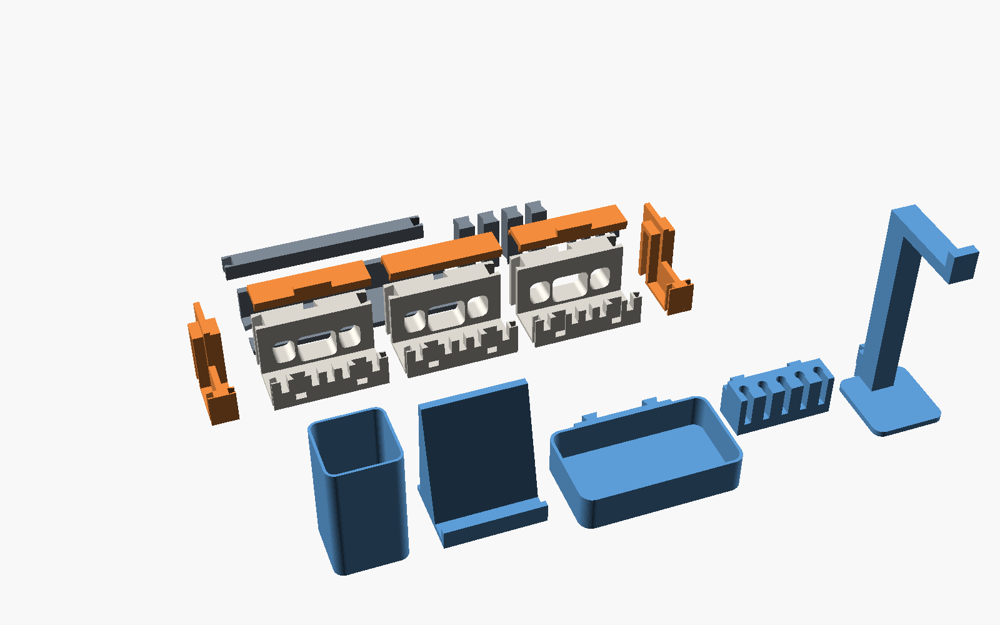

# desk-hub

A modular laptop riser. The laptop sits 55 mm up on two rails, with a cable tray along each side, a cable channel underneath, a slot for A4 documents, and organizers that slide into sockets on the trays. A vertical stand reuses the same parts.

It's sized for the ASUS ROG Strix G18 (2025, G815), but every length comes from `laptop_d` and `laptop_w` in `desk-hub.scad`, so it fits any laptop once you measure it. Every part fits a 256 mm bed (Bambu Lab P1S) and locks with printed keys, so you need no glue, screws or inserts.


## Design

Two cheeks carry the laptop on 20 mm rails along its edges, which leaves the bottom intake open. Stops at both ends and lips on both sides allow 1 mm of play, so the laptop can't slide off. The lid opens fully, with nothing above the deck.

Each cheek is three identical segments plus two identical end caps, keyed together. Every part works either way round, so ports can face you or the wall, and the spine and document slot can go at either end.

Cables drop from the ports into the tray, run along it to the spine, cross under the laptop and come out in the other tray. The spine sits behind the document slot, so cables and paper never meet.

PETG goes only where the laptop touches (rail caps and end caps, about 180 g). Everything else is PLA. The crossbars stop 5 mm below the laptop so they never carry its heat.


## Parts

| Part | Qty | Material | About |
| --- | --- | --- | --- |
| `segment` | 6 | PLA | 57 g |
| `end_cap` | 4 | PETG | 26 g |
| `rail_cap_lip` | 4 | PETG | 13 g |
| `rail_cap` | 2 | PETG | 13 g |
| `spine` | 2 | PLA | 51 g |
| `bar` | 4 | PLA | 22 g |
| `key_wall` | 8 | PLA | 6 g |
| `key_tray` | 8 | PLA | 2 g |
| `key_floor` | 3 | PLA | 2 g |
| `key_bar` | 6 | PLA | 2 g |

The riser takes about 620 g of PLA and 180 g of PETG at 3 walls and 15% gyroid.

Organizers (PLA, optional): `pen_cup`, `phone_stand`, `catch_tray`, `cable_dock`, `headphone_hook`. Each slides down into the sockets on the outside of a tray; there are two per segment, 50 mm apart.

Vertical stand: 2 `cradle`, 1 `spine` and 2 `key_floor`. It holds the laptop on its front edge with the exhaust up, and the spine between the cradles carries the cables. The lid stays shut while it stands.




## Before printing everything

1. Measure your laptop's underside, front to back and side to side, and set `laptop_d` and `laptop_w`.
2. Print `fit_coupon`, one of each key and `test_tail` in PLA. Each key should slide into its socket by hand without wobble. If they're tight or loose, change `fit` (default 0.2 mm per side).
3. Print one `end_cap` and one `rail_cap_lip` in PETG. Hold each against the laptop: the stop and the lip should touch the chassis below the ports and vents.


## Printing

Print every part in the orientation it's exported in, with no supports. The rail caps print flange side down.

## Assembly

1. Stand the floor keys on the desk where the spine meets the cheeks and where its halves meet.
2. Lower the spine halves and the two end segments onto them.
3. Join the segments and end caps of each cheek with the wall and tray keys. Wall keys go into the end caps from below.
4. Drop the bar halves and bar keys into the top sockets.
5. Press the rail caps onto the wall tops. They lock the bar keys and wall keys in place.

## Building

The STLs in `stl/` are exported from `desk-hub.scad` (OpenSCAD 2021.01):

```sh
openscad -D 'part="segment"' -o stl/segment.stl desk-hub.scad
```

`preview.scad` renders the images in `renders/`.

## License

CC BY-SA 4.0
