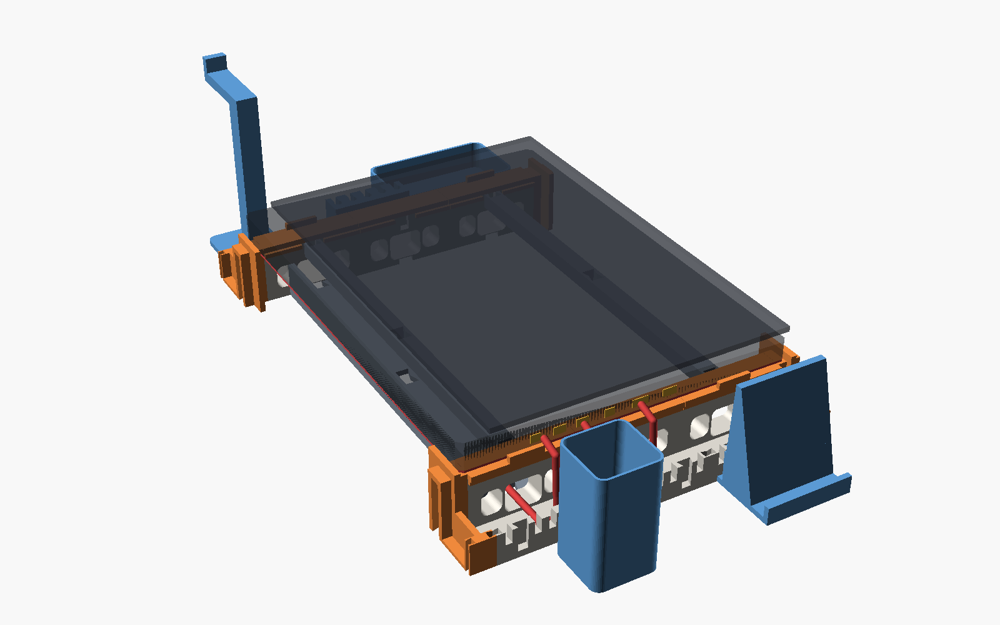
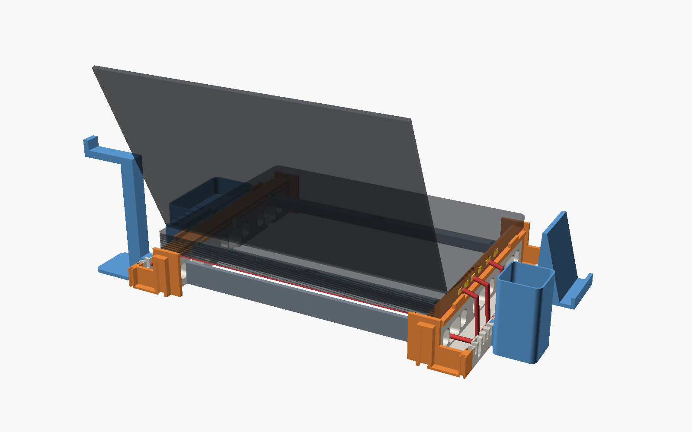
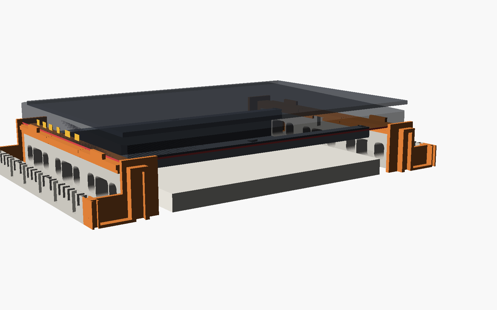
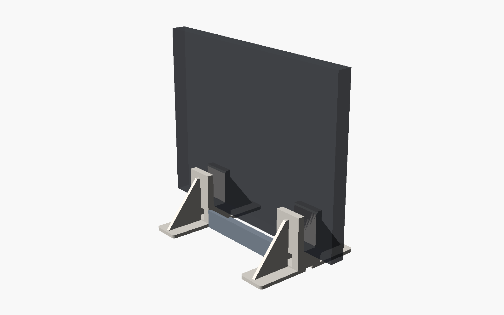
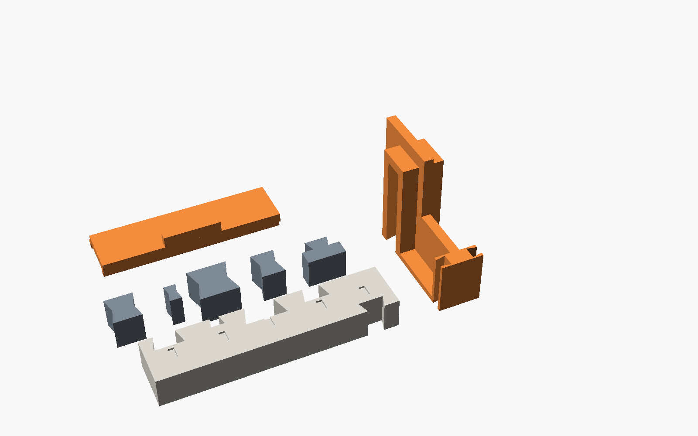

# desk-hub

A modular laptop riser. The laptop sits 55 mm up on two rails, with a cable tray along each side, a cable channel underneath, a slot for A4 documents, and organizers that slide into sockets on the trays. A vertical stand reuses the same parts.

It's sized for the ASUS ROG Strix G18 (2025, G815), but every length comes from `laptop_d` and `laptop_w` in `desk-hub.scad`, so it fits any laptop once you measure it. Every part fits a 256 mm bed (Bambu Lab P1S) and locks with printed keys, so you need no glue, screws or inserts.



## Design

Two cheeks carry the laptop on 20 mm rails along its edges, which leaves the bottom intake open. Stops at both ends and lips on both sides allow 1 mm of play, so the laptop can't slide off. The lid opens fully, with nothing above the deck.

Each cheek is three identical segments plus two identical end caps, keyed together. Every part works either way round, so ports can face you or the wall, and the spine and document slot can go at either end.

Cables drop from the ports into the tray, run along it to the spine, cross under the laptop and come out in the other tray. The spine sits behind the document slot, so cables and paper never meet.

PETG goes only where the laptop touches (rail caps and end caps, about 180 g). Everything else is PLA. The crossbars stop 5 mm below the laptop so they never carry its heat.




## Parts

| Part | Qty | Material | About |
| --- | --- | --- | --- |
| `segment` | 6 | PLA | 57 g |
| `end_cap` | 4 | PETG | 26 g |
| `rail_cap_lip` | 4 | PETG | 13 g |
| `rail_cap` | 2 | PETG | 13 g |
| `lip_clip` | 4 | PETG | 2 g |
| `spine` | 2 | PLA | 51 g |
| `bar` | 4 | PLA | 22 g |
| `key_wall` | 8 | PLA | 6 g |
| `key_tray` | 8 | PLA | 2 g |
| `key_floor` | 3 | PLA | 2 g |
| `key_bar` | 6 | PLA | 2 g |

The riser takes about 620 g of PLA and 180 g of PETG at 3 walls and 15% gyroid.

Organizers (PLA, optional): `pen_cup`, `phone_stand`, `catch_tray`, `cable_dock`, `headphone_hook`. Each slides down into the sockets on the outside of a tray; there are two per segment, 50 mm apart.

Vertical stand: 2 `cradle`, 1 `spine` and 2 `key_floor`. It holds the laptop on its front edge with the exhaust up, and the spine between the cradles carries the cables. The lid stays shut while it stands.




## Printing in Bambu Studio

Every STL is exported in its print orientation and needs no supports. These steps are for a Bambu Lab P1S with a 0.4 mm nozzle. Each material gets its own project, so you only swap the spool once.

### Settings for every plate

1. Printer: **Bambu Lab P1S 0.4 nozzle**.
2. Process: **0.20mm Standard @BBL X1C** (the P1S uses the X1C process presets).
3. In the process **Strength** tab, set **Wall loops** to 3, **Sparse infill density** to 15% and **Sparse infill pattern** to Gyroid.
4. Support: leave **Enable support** off.
5. Filament: **Bambu PLA Basic** or **Generic PLA** for PLA projects, **Generic PETG** for PETG projects.

To make copies of a part, right-click it and choose **Clone** (Ctrl+M), then enter the count. Use **Add Plate** in the toolbar for more plates, drag parts onto them, and press **Arrange** on each plate. To slice, pick **Slice all** from the **Slice plate** menu, then **Print plate**.

### Before you start

Measure the laptop's underside front to back and side to side. Set `laptop_d` and `laptop_w` at the top of `desk-hub.scad`, then re-export the STLs (see Building). The defaults are the Strix G18's 299 x 399 mm.

### Step 1: test print

Print this before anything else. It's about 50 g and checks the joint fit and the laptop fit.

1. New PLA project. Import (Ctrl+I) `stl/fit_coupon.stl`, `stl/key_wall.stl`, `stl/key_tray.stl`, `stl/key_floor.stl`, `stl/key_bar.stl` and `stl/test_tail.stl`, one of each, on one plate. Slice and print.
2. New PETG project. Import `stl/end_cap.stl`, `stl/rail_cap_lip.stl` and `stl/lip_clip.stl`, one of each, on one plate. Slice and print. These are real parts, so keep them.
3. Push each key and the tail into its socket on the coupon. They should slide in by hand and not wobble. Too tight: raise `fit` in `desk-hub.scad` by 0.05. Loose: lower it by 0.05. Then re-export the STLs.
4. Hold the end cap against one end of the laptop with both on the desk. The orange stop should touch the chassis below the vents. Snap the lip clip onto the rail cap's notched edge and hold it against the port side the same way; it should sit below the ports.

To check `laptop_d` and `laptop_w` before printing the riser, print the footprint gauge (PLA, about 95 g): `gauge_corner` x2, `gauge_corner_mirror` x2, `gauge_strap_y` x4, `gauge_strap_x` x2 and `gauge_key` x10. Lay it out like `part="gauge"` in OpenSCAD and join it with the keys. The stops and lips sit where the riser's do, so the laptop should drop in with 1 mm to spare at each. Tight: raise the dimension by the shortfall. Rattles: lower it.

### Step 2: the riser

PLA project, three plates:

| Plate | Parts |
| --- | --- |
| 1 | `segment` x6 |
| 2 | `spine` x2, `bar` x4 |
| 3 | `key_wall` x8, `key_tray` x8, `key_floor` x3, `key_bar` x6 |

PETG project, one plate:

| Plate | Parts |
| --- | --- |
| 1 | `end_cap` x3, `rail_cap_lip` x3, `rail_cap` x2, `lip_clip` x3 (plus the test print's PETG parts) |

The rail caps print top face down. Stood on their flanges, the top plate warps them off the bed.

### Step 3: organizers and vertical stand (optional, PLA)

| Plate | Parts |
| --- | --- |
| 1 | `pen_cup`, `phone_stand`, `catch_tray`, `cable_dock` |
| 2 | `headphone_hook` |
| 3 | `cradle` x2, `spine` x1, `key_floor` x2 (vertical stand only) |



## Assembly

1. Stand the floor keys on the desk where the spine meets the cheeks and where its halves meet.
2. Lower the spine halves and the two end segments onto them.
3. Join the segments and end caps of each cheek with the wall and tray keys. Wall keys go into the end caps from below.
4. Drop the bar halves and bar keys into the top sockets.
5. Press the rail caps onto the wall tops, notched caps on the end segments with the notch over the tray. They lock the bar keys and wall keys in place.
6. Snap a lip clip into each notch, hook first under the flange.

## Building

The STLs in `stl/` are exported from `desk-hub.scad` (OpenSCAD 2021.01):

```sh
openscad -D 'part="segment"' -o stl/segment.stl desk-hub.scad
```

`preview.scad` renders the images in `renders/`.

## License

CC BY-SA 4.0
